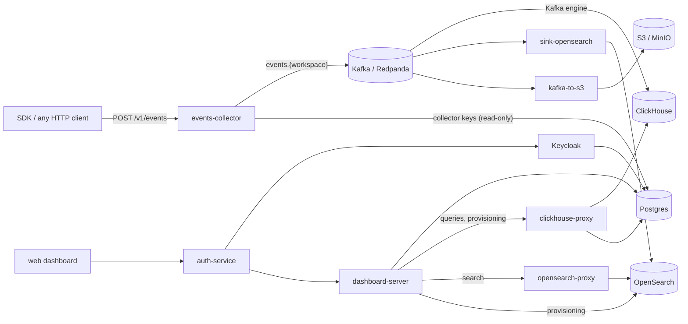

# SudoQuery

SudoQuery is a self-hostable product analytics platform. Your apps send events
through a lightweight SDK. SudoQuery streams them through Kafka into ClickHouse
(for analytics), OpenSearch (for search) and S3 (for archiving). A web
dashboard then lets your team explore the data:

- **Chat with your data:** ask questions in plain English. An LLM assistant
  writes and runs ClickHouse queries for you and charts the answers.
- **Discover:** a Kibana-style event explorer with KQL search, filters, field
  stats and a histogram.
- **Sessions:** follow what a user did, event by event, on a timeline.
- **SQL console:** run ClickHouse SQL directly, with tabs and saved consoles.
- **Live dashboards and saved metrics:** bar, line, pie, funnel and Sankey
  charts.
- **Event schema:** browse and describe the events and properties you collect.
- **Multi-tenant:** organizations, workspaces, members, roles and invitations,
  with SSO through Keycloak.

## Architecture



Every **workspace** is fully isolated, with its own:

- Kafka topic, `events.{workspace_id}`
- ClickHouse database and user, created from [`ckh/workspace.sql`](ckh/workspace.sql)
- OpenSearch data stream, `events-{org_id}-{workspace_id}`

`dashboard-server` provisions these resources when a workspace is created and
removes them when it is deleted; it asks clickhouse-proxy for the ClickHouse
database and user. See [workspace provisioning](xtask/README.md#setup-services)
for how the lifecycle works.

Every event, from the collector onwards, uses one wire format: `CanonicalEvent`
in [`crates/canonical-event`](crates/canonical-event/src/lib.rs).

## Repository layout

| Path | What it is |
|---|---|
| [`crates/events-collector`](crates/events-collector) | HTTP ingestion API (Rust/axum). It validates events, enriches them (arrival time, client IP, country) and publishes them to the workspace's Kafka topic. Settings come from a [CAC/Superposition config](crates/events-collector/cac.toml) and can be overridden per org or workspace |
| [`crates/dashboard-server`](crates/dashboard-server) | Backend API for the dashboard (Rust/axum, Postgres via SeaORM/sqlx). It handles orgs, workspaces, members, invitations, ClickHouse queries, OpenSearch search, sessions, LLM chat and workspace provisioning |
| [`crates/clickhouse-proxy`](crates/clickhouse-proxy) | Everything ClickHouse (Rust/axum): runs SQL as each workspace's own ClickHouse user, creates and drops each workspace's ClickHouse database and user, and keeps saved SQL consoles and event and property descriptions in its own Postgres tables (its own schema and migrations). dashboard-server and the CDP dashboard both call it |
| [`crates/opensearch-proxy`](crates/opensearch-proxy) | Event search over OpenSearch (Rust/axum): Discover's events, histogram, field facets and sessions, one workspace at a time. dashboard-server checks access and forwards to it; the CDP dashboard uses it the same way. Also the library dashboard-server's provisioning uses for data streams |
| [`crates/sink-opensearch`](crates/sink-opensearch) | Kafka → OpenSearch indexer with at-least-once delivery, no duplicates and a DLQ. See its [README](crates/sink-opensearch/README.md) and [SPEC](crates/sink-opensearch/SPEC.md) |
| [`crates/kafka-to-s3`](crates/kafka-to-s3) | Kafka → S3 archiver. It writes zstd-compressed JSONL partitioned by org, workspace, date and hour. See its [README](crates/kafka-to-s3/README.md) |
| [`crates/canonical-event`](crates/canonical-event) | Shared event type and org/workspace slug validation |
| [`clients/typescript`](clients/typescript) | `sudo-query` SDK for browser and Node.js (npm). It batches events, tracks anonymous IDs and supports super properties. Includes a [Shopify integration](clients/typescript/shopify) and an [HTML demo](clients/typescript/html-demo). See its [README](clients/typescript/README.md) |
| [`web/dashboard`](web/dashboard) | Dashboard UI (React 19, Vite, MUI) |
| [`xtask`](xtask) | `cargo xtask` dev task runner for formatting, linting, tests, Docker Compose, DB migrations and e2e suites. See its [README](xtask/README.md) |
| [`migrations`](migrations) | Postgres migrations for dashboard-server, in sqlx format |
| [`ckh`](ckh) | ClickHouse per-workspace schema and chproxy config |
| [`keycloak/import`](keycloak/import) | Keycloak realms for local dev, including a mock "Google" IdP |
| [`docker-compose.yml`](docker-compose.yml) | The local infrastructure stack |

## Getting started

### Prerequisites

- Rust (stable, edition 2024) and Cargo
- Docker with Docker Compose
- Node.js 20+ and npm (for the dashboard and SDK)

### 1. Start the infrastructure

```bash
cargo xtask setup        # interactive; press Enter to start everything
cargo xtask ps           # check that containers are up and healthy
```

| Service | Local address |
|---|---|
| Postgres | `localhost:5433` |
| Redpanda (Kafka) | `localhost:19092`, Console at http://localhost:8081 |
| ClickHouse | http://localhost:8123 (native TCP on `19000`), chproxy on `9090` |
| OpenSearch | http://localhost:9200, Dashboards at http://localhost:5601 |
| Keycloak | http://localhost:8080 (`admin` / `admin`) |
| MinIO | http://localhost:9000, console at http://localhost:9001 (`minioadmin` / `minioadmin`) |
| LocalStack (KMS) | http://localhost:4566 |

### 2. Migrate the database

```bash
cargo xtask db migration
cargo xtask db status    # must report 0 pending
```

### 3. Run the services

The collector and dashboard-server both default to port `3000`, so give one
of them a different port:

```bash
# Dashboard API on :3000
ADMIN_API_TOKEN=dev-admin-token cargo run -p hyper-analytics-dashboard-server

# Event collector on :3001
SERVER_ADDR=0.0.0.0:3001 SERVER_ACCEPT_CORS=true \
  COLLECTOR_CONFIG=crates/events-collector/cac.toml \
  cargo run -p event-collector

# ClickHouse queries, provisioning, consoles and descriptions, on :3003
cargo run -p clickhouse-proxy

# Event search for Discover, on :3002
cargo run -p opensearch-proxy

# Optional sinks
SINK_CONFIG=crates/sink-opensearch/cac.toml cargo run -p sink-opensearch
cargo run -p kafka-to-s3   # see its README for the required env vars
```

dashboard-server reads a `.env` file in its working directory. Main settings:

| Variable | Purpose / default |
|---|---|
| `DATABASE_URL` | Postgres connection string |
| `DASHBOARD_BIND_ADDR` | `0.0.0.0:3000` |
| `KEYCLOAK_URL`, `KEYCLOAK_REALM`, `KEYCLOAK_ADMIN_USER`, `KEYCLOAK_ADMIN_PASS` | Keycloak access |
| `CLICKHOUSE_PROXY_URL`, `CLICKHOUSE_PROXY_TOKEN` | `http://localhost:3003`; the token clickhouse-proxy requires, if it has one |
| `KAFKA_BROKER_URL` | `localhost:19092` |
| `WORKSPACE_TOPIC_TEMPLATE` | `events.{workspace_id}` |
| `OPENSEARCH_URL`, `OPENSEARCH_INDEX` | `http://localhost:9200`, `events-{org_id}-{workspace_id}`; used to create and delete data streams |
| `OPENSEARCH_PROXY_URL`, `OPENSEARCH_PROXY_TOKEN` | `http://localhost:3002`; the token opensearch-proxy requires, if it has one |
| `ADMIN_API_TOKEN` | Enables the admin (provisioning) API |
| `LLM_API_KEY`, `LLM_API_ENDPOINT` | OpenAI-compatible chat completions endpoint for the chat assistant |

clickhouse-proxy reads a `.env` file too:

| Variable | Purpose / default |
|---|---|
| `CLICKHOUSE_PROXY_ADDR` | `0.0.0.0:3003` |
| `DATABASE_URL`, `DATABASE_SCHEMA` | Postgres for its own tables; `clickhouse_proxy`. It creates the schema and runs its migrations at startup, so it can share a database with dashboard-server |
| `CLICKHOUSE_URL`, `CLICKHOUSE_ADMIN_URL`, `CLICKHOUSE_ADMIN_USER`, `CLICKHOUSE_ADMIN_PASSWORD` | `http://localhost:8123`, `default` |
| `CLICKHOUSE_WORKSPACE_PASSWORD` | Password of every workspace's ClickHouse user |
| `CLICKHOUSE_KAFKA_BROKERS` | `redpanda:9092`; brokers as ClickHouse sees them, for workspace Kafka tables |
| `CLICKHOUSE_PROXY_TOKEN` | Bearer token callers must send. Unset, any caller can query, provision or drop any workspace, so set it anywhere but local dev |

Its API is under `/v1/workspaces/{workspace_id}`:

| Endpoint | What it does |
|---|---|
| `POST query` | Runs SQL as the workspace's user, in its database; ClickHouse's JSON answer |
| `GET events`, `GET events/today-count?timezone=`, `GET events/{name}/properties` | Event names, today's count, an event's property paths |
| `GET schema` | Every event with its properties, types and descriptions |
| `GET`, `PUT event-descriptions/{event}`; `GET event-descriptions` | Event descriptions |
| `GET`, `PUT property-descriptions/{event}/{property}`; `GET property-descriptions?event_name=` | Property descriptions |
| `GET`, `POST owners/{owner}/consoles`; `GET`, `PATCH`, `DELETE owners/{owner}/consoles/{id}` | A person's saved SQL consoles |
| `PUT`, `DELETE database` (body `{"topic"}`); `PUT`, `DELETE user` | The workspace's ClickHouse database and read-only user |

Workspace ids are checked before they reach ClickHouse, and ClickHouse's own
names (`default`, `system`, `information_schema`) are refused. The consoles,
event descriptions and property descriptions that dashboard-server kept in
its own tables (`user_workspace_consoles`, `event_descriptions`,
`property_descriptions`) are no longer read; copy them over if you need them.

opensearch-proxy reads a `.env` file too:

| Variable | Purpose / default |
|---|---|
| `OPENSEARCH_PROXY_ADDR` | `0.0.0.0:3002` |
| `OPENSEARCH_URL`, `OPENSEARCH_INDEX` | `http://localhost:9200`, `events-{org_id}-{workspace_id}`; must name what sink-opensearch writes to |
| `OPENSEARCH_USERNAME`, `OPENSEARCH_PASSWORD` | Basic auth to OpenSearch; both or neither |
| `OPENSEARCH_REQUEST_TIMEOUT_MS` | `30000` |
| `OPENSEARCH_PROXY_TOKEN` | Bearer token callers must send. Unset, any caller can search any workspace, so set it anywhere but local dev |

The API, all `POST` with a JSON body except `doc`, is under
`/v1/orgs/{org_id}/workspaces/{workspace_id}/events`: `search`, `count`,
`doc/{id}`, `histogram`, `facets`, `sessions` and `sessions/{session_id}`.
The caller decides who may read which workspace; the proxy confines every
query to the workspace in the path.

### 4. Run the dashboard

```bash
cd web/dashboard
cp .env.example .env.local   # points at localhost:3000 and the local Keycloak
npm install
npm run dev                  # http://localhost:5173
```

Sign in through Keycloak, then create an organization and a workspace. The
workspace stays `PENDING` until it is provisioned:

```bash
curl -X POST -H 'X-Admin-Token: dev-admin-token' \
  http://localhost:3000/api/admin/workspaces/<workspace_id>/provision
```

### 5. Send events

You can send events with the SDK:

```ts
import { SudoQuery } from 'sudo-query';

SudoQuery.init({
  endpoint: 'http://localhost:3001/v1/events/batch',
  orgId: '<org_id>',
  workspaceId: '<workspace_id>',
});

SudoQuery.track('checkout_started', { cart_value: 499, currency: 'INR' });
```

Or call the collector over plain HTTP:

```bash
curl -X POST http://localhost:3001/v1/events/batch \
  -H 'Content-Type: application/json' \
  -H 'x-org-id: <org_id>' \
  -H 'x-workspace-id: <workspace_id>' \
  -d '{
    "events": [{
      "envelop_version": "1.0",
      "id": "0b9c6a6e-6f0e-4d3e-9a43-3c1f4e2b7a10",
      "name": "page_view",
      "org_id": "<org_id>",
      "workspace_id": "<workspace_id>",
      "anon_id": "anon-123",
      "occured_at": "2026-10-27T10:00:00Z",
      "properties": { "path": "/checkout" }
    }]
  }'
```

Collector endpoints (all under `/v1`):

| Endpoint | Body |
|---|---|
| `POST /events/batch` | `{ "events": [...], "system_properties": {...} }` |
| `POST /events` | One or more concatenated event objects |
| `POST /events/authenticated` | Same as `/events`, but needs a collector key; its events are marked `authenticated` |
| `GET /health` | Kafka and auth health |

The `x-org-id` and `x-workspace-id` headers must match the ids in the events.
On `/events/authenticated` the key decides the org and workspace instead: the
headers are optional there, and must name the key's when sent.

A collector key is `sk_<kid>_<secret>`, sent as `Authorization: Bearer <key>`.
Keys are created outside the collector, by whichever dashboard owns the
`collector_keys` table ([`crates/events-collector/collector_keys.sql`](crates/events-collector/collector_keys.sql)
has the schema and the key format); the collector only reads that table,
from `COLLECTOR_KEYS_DATABASE_URL`, caching each lookup for
`COLLECTOR_KEYS_CACHE_SECS` (default 30), so a revoked key stops working
within that time. Without `COLLECTOR_KEYS_DATABASE_URL` the authenticated
endpoint answers 503.
An org's id is the slug given when it is created (`POST /api/organizations`
with `{"name": "North Star", "slug": "north_star"}`): 3–30 lowercase letters,
digits and `_`, starting with a letter and ending with a letter or digit. A
workspace is created with its own slug, unique in the org
(`{"name": "Web Shop", "slug": "web_shop"}`), and its id is the org's id and
that slug joined by `-`: `north_star-web_shop`. Workspace ids are therefore
unique across orgs, and name the workspace's topic and ClickHouse database
on their own. Both are permanent; names can change.

The events then appear in the dashboard's Chat, Discover, Sessions and SQL
console.

## Development

Everyday tasks go through `cargo xtask`. See the [full reference](xtask/README.md).

```bash
cargo xtask ci                     # fmt --check + clippy + test (the CI gate)
cargo xtask db migration add name  # new Postgres migration
cargo xtask e2e dashboard          # end-to-end suites: dashboard | collector | kafka-to-s3
```

To work on the dashboard, run these in `web/dashboard`: `npm run lint`,
`npm test` (vitest) and `npm run build`. To work on the SDK, run these in
`clients/typescript`: `npm test` and `npm run build`.

## Builds and releases

GitHub Actions builds multi-arch Docker images for `dashboard-server`,
`event-collector`, `sink-opensearch`, `kafka-to-s3` and `web-dashboard`, and
publishes them to `ghcr.io/<owner>/<repo>/<image>`. Pushing a `v*` tag
publishes the TypeScript SDK to npm.
