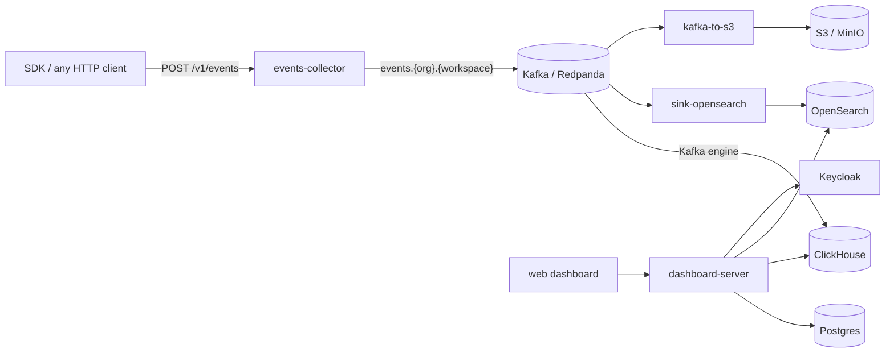

# SudoQuery

SudoQuery is a self-hostable product analytics platform. Your apps send events
through a lightweight SDK. SudoQuery streams them through Kafka into ClickHouse
(for analytics), OpenSearch (for search) and S3 (for archiving). A web
dashboard then lets your team explore the data:

- **Chat with your data:** ask questions in plain English. An LLM assistant
  writes and runs ClickHouse queries for you and charts the answers.
- **Discover:** a Kibana-style event explorer with KQL search, filters, field
  stats and a histogram.
- **Sessions:** follow what a user did, event by event, on a timeline.
- **SQL console:** run ClickHouse SQL directly, with tabs and saved consoles.
- **Live dashboards and saved metrics:** bar, line, pie, funnel and Sankey
  charts.
- **Event schema:** browse and describe the events and properties you collect.
- **Multi-tenant:** organizations, workspaces, members, roles and invitations,
  with SSO through Keycloak.

## Architecture



Every **workspace** is fully isolated, with its own:

- Kafka topic, `events.{org_id}.{workspace_id}`
- ClickHouse database and user, created from [`ckh/workspace.sql`](ckh/workspace.sql)
- OpenSearch data stream, `events-{org_id}-{workspace_id}`

`dashboard-server` provisions these resources when a workspace is created and
removes them when it is deleted. See [workspace provisioning](xtask/README.md#setup-services)
for how the lifecycle works.

Every event, from the collector onwards, uses one wire format: `CanonicalEvent`
in [`crates/canonical-event`](crates/canonical-event/src/lib.rs).

## Repository layout

| Path | What it is |
|---|---|
| [`crates/events-collector`](crates/events-collector) | HTTP ingestion API (Rust/axum). It validates events, enriches them (arrival time, client IP, country) and publishes them to the workspace's Kafka topic. Settings come from a [CAC/Superposition config](crates/events-collector/cac.toml) and can be overridden per org or workspace |
| [`crates/dashboard-server`](crates/dashboard-server) | Backend API for the dashboard (Rust/axum, Postgres via SeaORM/sqlx). It handles orgs, workspaces, members, invitations, ClickHouse queries, OpenSearch search, sessions, LLM chat and workspace provisioning |
| [`crates/sink-opensearch`](crates/sink-opensearch) | Kafka → OpenSearch indexer with at-least-once delivery, no duplicates and a DLQ. See its [README](crates/sink-opensearch/README.md) and [SPEC](crates/sink-opensearch/SPEC.md) |
| [`crates/kafka-to-s3`](crates/kafka-to-s3) | Kafka → S3 archiver. It writes zstd-compressed JSONL partitioned by org, workspace, date and hour. See its [README](crates/kafka-to-s3/README.md) |
| [`crates/canonical-event`](crates/canonical-event) | Shared event type and org/workspace slug validation |
| [`clients/typescript`](clients/typescript) | `sudo-query` SDK for browser and Node.js (npm). It batches events, tracks anonymous IDs and supports super properties. Includes a [Shopify integration](clients/typescript/shopify) and an [HTML demo](clients/typescript/html-demo). See its [README](clients/typescript/README.md) |
| [`web/dashboard`](web/dashboard) | Dashboard UI (React 19, Vite, MUI) |
| [`xtask`](xtask) | `cargo xtask` dev task runner for formatting, linting, tests, Docker Compose, DB migrations and e2e suites. See its [README](xtask/README.md) |
| [`migrations`](migrations) | Postgres migrations for dashboard-server, in sqlx format |
| [`ckh`](ckh) | ClickHouse per-workspace schema and chproxy config |
| [`keycloak/import`](keycloak/import) | Keycloak realms for local dev, including a mock "Google" IdP |
| [`docker-compose.yml`](docker-compose.yml) | The local infrastructure stack |

## Getting started

### Prerequisites

- Rust (stable, edition 2024) and Cargo
- Docker with Docker Compose
- Node.js 20+ and npm (for the dashboard and SDK)

### 1. Start the infrastructure

```bash
cargo xtask setup        # interactive; press Enter to start everything
cargo xtask ps           # check that containers are up and healthy
```

| Service | Local address |
|---|---|
| Postgres | `localhost:5433` |
| Redpanda (Kafka) | `localhost:19092`, Console at http://localhost:8081 |
| ClickHouse | http://localhost:8123 (native TCP on `19000`), chproxy on `9090` |
| OpenSearch | http://localhost:9200, Dashboards at http://localhost:5601 |
| Keycloak | http://localhost:8080 (`admin` / `admin`) |
| MinIO | http://localhost:9000, console at http://localhost:9001 (`minioadmin` / `minioadmin`) |
| LocalStack (KMS) | http://localhost:4566 |

### 2. Migrate the database

```bash
cargo xtask db migration
cargo xtask db status    # must report 0 pending
```

### 3. Run the services

The collector and dashboard-server both default to port `3000`, so give one
of them a different port:

```bash
# Dashboard API on :3000
ADMIN_API_TOKEN=dev-admin-token cargo run -p hyper-analytics-dashboard-server

# Event collector on :3001
SERVER_ADDR=0.0.0.0:3001 SERVER_ACCEPT_CORS=true \
  COLLECTOR_CONFIG=crates/events-collector/cac.toml \
  cargo run -p event-collector

# Optional sinks
SINK_CONFIG=crates/sink-opensearch/cac.toml cargo run -p sink-opensearch
cargo run -p kafka-to-s3   # see its README for the required env vars
```

dashboard-server reads a `.env` file in its working directory. Main settings:

| Variable | Purpose / default |
|---|---|
| `DATABASE_URL` | Postgres connection string |
| `DASHBOARD_BIND_ADDR` | `0.0.0.0:3000` |
| `KEYCLOAK_URL`, `KEYCLOAK_REALM`, `KEYCLOAK_ADMIN_USER`, `KEYCLOAK_ADMIN_PASS` | Keycloak access |
| `CLICKHOUSE_URL`, `CLICKHOUSE_ADMIN_URL`, `CLICKHOUSE_ADMIN_USER`, `CLICKHOUSE_ADMIN_PASSWORD` | `http://localhost:8123`, `default` |
| `CLICKHOUSE_KAFKA_BROKERS` | Brokers as ClickHouse sees them |
| `KAFKA_BROKER_URL` | `localhost:19092` |
| `WORKSPACE_TOPIC_TEMPLATE` | `events.{org_id}.{workspace_id}` |
| `OPENSEARCH_URL`, `OPENSEARCH_INDEX` | `http://localhost:9200`, `events-{org_id}-{workspace_id}` |
| `ADMIN_API_TOKEN` | Enables the admin (provisioning) API |
| `LLM_API_KEY`, `LLM_API_ENDPOINT` | OpenAI-compatible chat completions endpoint for the chat assistant |

### 4. Run the dashboard

```bash
cd web/dashboard
cp .env.example .env.local   # points at localhost:3000 and the local Keycloak
npm install
npm run dev                  # http://localhost:5173
```

Sign in through Keycloak, then create an organization and a workspace. The
workspace stays `PENDING` until it is provisioned:

```bash
curl -X POST -H 'X-Admin-Token: dev-admin-token' \
  http://localhost:3000/api/admin/workspaces/<workspace_id>/provision
```

### 5. Send events

You can send events with the SDK:

```ts
import { SudoQuery } from 'sudo-query';

SudoQuery.init({
  endpoint: 'http://localhost:3001/v1/events/batch',
  orgId: '<org_id>',
  workspaceId: '<workspace_id>',
});

SudoQuery.track('checkout_started', { cart_value: 499, currency: 'INR' });
```

Or call the collector over plain HTTP:

```bash
curl -X POST http://localhost:3001/v1/events/batch \
  -H 'Content-Type: application/json' \
  -H 'x-org-id: <org_id>' \
  -H 'x-workspace-id: <workspace_id>' \
  -d '{
    "events": [{
      "envelop_version": "1.0",
      "id": "0b9c6a6e-6f0e-4d3e-9a43-3c1f4e2b7a10",
      "name": "page_view",
      "org_id": "<org_id>",
      "workspace_id": "<workspace_id>",
      "anon_id": "anon-123",
      "occured_at": "2026-10-27T10:00:00Z",
      "properties": { "path": "/checkout" }
    }]
  }'
```

Collector endpoints (all under `/v1`):

| Endpoint | Body |
|---|---|
| `POST /events/batch` | `{ "events": [...], "system_properties": {...} }` |
| `POST /events` | One or more concatenated event objects |
| `POST /events/authenticated` | Same as `/events`, but needs a KMS-encrypted bearer token |
| `GET /health` | Kafka and auth health |

The `x-org-id` and `x-workspace-id` headers must match the ids in the events.
Org and workspace ids are server-generated slugs, 6–30 characters long, made
of lowercase letters, digits and `-`.

The events then appear in the dashboard's Chat, Discover, Sessions and SQL
console.

## Development

Everyday tasks go through `cargo xtask`. See the [full reference](xtask/README.md).

```bash
cargo xtask ci                     # fmt --check + clippy + test (the CI gate)
cargo xtask db migration add name  # new Postgres migration
cargo xtask e2e dashboard          # end-to-end suites: dashboard | collector | kafka-to-s3
```

To work on the dashboard, run these in `web/dashboard`: `npm run lint`,
`npm test` (vitest) and `npm run build`. To work on the SDK, run these in
`clients/typescript`: `npm test` and `npm run build`.

## Builds and releases

GitHub Actions builds multi-arch Docker images for `dashboard-server`,
`event-collector`, `sink-opensearch`, `kafka-to-s3` and `web-dashboard`, and
publishes them to `ghcr.io/<owner>/<repo>/<image>`. Pushing a `v*` tag
publishes the TypeScript SDK to npm.
